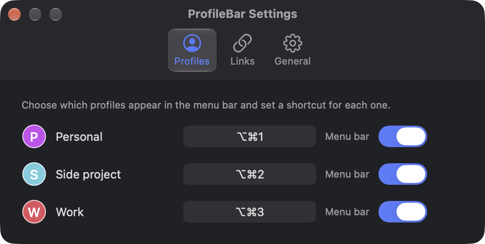

  

<h1 align="center">ProfileBar</h1>

Switch Chrome profiles instantly. Move tabs between them with ProfileBar for Chrome.

  <a href="https://afrojun.dev/profilebar/">Website</a> ·
  <a href="https://github.com/afrojun/profilebar/releases/latest">Download</a>

  

ProfileBar puts your Chrome profiles in the macOS menu bar. Click a profile avatar or press its keyboard shortcut to switch in one step, without opening Chrome's **Profiles** menu.

If that profile already has a window open, ProfileBar brings it forward, even from another desktop Space. If it does not, ProfileBar opens the profile normally.

## Move tabs between profiles

Install the [ProfileBar for Chrome](https://chromewebstore.google.com/detail/pkibfaoenoibogibnlkkpmgagjckjijh) extension to move tabs from the
right-click menu. Right-click a page and choose **Move tab to profile**, or
right-click a tab and choose **Move tabs to profile**. The extension closes the
original tabs after ProfileBar reports success. ProfileBar registers the local
Chrome helper when it launches. If the extension cannot find it, launch
ProfileBar and choose **Refresh profiles** from the extension menu.

Select several tabs and right-click one of them to move them together in tab
order. To move a whole tab group, right-click a tab inside it and choose
**Move group to [profile]**. If ProfileBar for Chrome is also installed in the
destination profile, it recreates the group title, colour, and collapsed state.
Otherwise, ProfileBar opens the URLs without a group. The group items appear
while the window has a tab group, because Chrome does not tell extensions which
tab was right-clicked until an item is chosen.

Give each Chrome profile its own name. When two profiles share a name, the
extension labels them by folder (such as Profile 3) and cannot tell which of
them you are in. Its setup page offers a **Rename** button for each one, which
opens that profile's Chrome settings.

Chrome installs extensions per profile, so add ProfileBar for Chrome to each
profile you move tabs from. To copy tab URLs, use
[Instant Copy URL](https://afrojun.dev/instant-copy-url/).

## Open links in the right profile

Link routing opens new tabs in the profile you choose for each site. Chrome
stays your default browser and ProfileBar never becomes one. A link from
another app or a link that a page opens in a new tab moves to its profile in
about a tenth of a second.

To set it up:

1. Add ProfileBar for Chrome to each profile that should route links or receive them.
2. Open the extension's options page and choose **Identify profiles** once.
   Each profile briefly opens a tab so the extension learns which profile it runs in.
3. Add rules in the options page or on the **Links** tab of ProfileBar **Settings…**.
   Both edit the same rules. You can also right-click a page and choose
   **Always open this site in**.

A rule matches a site and its subdomains, optionally under a path such as
`github.com/team`, or any URL that contains some text. Site rules win over
"URL contains" rules, and longer sites, paths, and text win over shorter ones.
To check a rule, paste a link into **Test a link** in either editor. It names the
profile the link opens in and the rule that sends it there.

Links that match no rule stay where Chrome opens them. To send links from other
apps that match no rule to one profile, as Finicky's default browser does,
choose it under **Open other links from apps in**. Links that pages open never
use it.

Link routing never moves:

- Navigation inside an existing tab, popup windows such as sign-in windows, or
  sign-in sites such as `accounts.google.com`.
- Tabs that Chrome opens in its first 3 seconds, so restored tabs stay put. A
  link that starts Chrome opens in the last profile you used.

Clear **Other apps** or **Web pages** under **Route links from** to stop routing
from that source. Clear both to turn link routing off.

## Use it

Each avatar in the menu bar belongs to one Chrome profile. Click the one you want and ProfileBar will switch to it or open it as needed.

Open **Settings…** from the ProfileBar button. It has three tabs:

- **Profiles**: set a global keyboard shortcut for each profile and choose which avatars stay in the menu bar.
- **Links**: edit the link-routing rules and find ProfileBar for Chrome.
- **General**: start ProfileBar automatically when you sign in and check Accessibility access.

  

Profile shortcuts work from any app. ProfileBar only registers the combinations you assign; it does not monitor what you type.

## Updates

Choose **Check for Updates…** from the ProfileBar menu at any time. ProfileBar also checks about 10 seconds after launch when it has not checked successfully in the last 24 hours, then once per day while it remains open. Automatic checks stay quiet unless a new version is available.

The check reads the latest public release from GitHub and identifies the installed ProfileBar version in its request. It does not send profile names, browser activity, or other app data. Installing an update still uses the signed DMG from [GitHub Releases](https://github.com/afrojun/profilebar/releases).

## Install

1. Download the latest `.dmg` from [GitHub Releases](https://github.com/afrojun/profilebar/releases).
2. Open it and drag **ProfileBar** to **Applications**.
3. Launch ProfileBar from Applications.

The first time you switch to an open profile, macOS asks you to allow ProfileBar in **System Settings → Privacy & Security → Accessibility**. Grant access, then select the profile again.

Current releases require macOS 14 or later and an Apple silicon Mac.

## Why Accessibility access?

Chrome does not provide a public API for bringing a specific profile window to the front. ProfileBar uses macOS Accessibility to raise a matching window first. If there is no window, it tries Chrome's profile command without showing the menu. Profiles that share a name have identical window titles, so ProfileBar always uses Chrome's profile command for them.

ProfileBar reads Chrome's local profile list and saved avatars. Its helper checks
the focused Chrome window title to identify the current profile for the
extension menu; when it cannot identify one uniquely, the extension shows every
profile. For an explicit tab or group move, the helper receives the selected
URLs and profile directory from the extension and passes them to Chrome. Group
moves also carry the visible group details through a temporary local relay when
the destination extension can receive them. For link routing, the helper
receives a new tab's URL when a rule, or the profile you chose for other links
from apps, sends it to another profile. ProfileBar does not store the URLs
or send profile data to a server. Ordinary profile switching never uses the
current page URL. ProfileBar does not bypass macOS permission controls.

## Limitations

- Profile switching currently expects Chrome's **Profiles** menu to be in English.
- ProfileBar cannot turn the current Chrome window into a different profile.
- If Chrome changes its menu or window labels, ProfileBar may need an update.
- The extension opens HTTP and HTTPS URLs in another profile. Chrome 150 and later show its menu on tabs and pages; older supported versions show it on pages.

## Help and feedback

Open **Settings…** and choose **Help & Feedback** to report a bug or suggest an improvement. You can also [open an issue directly](https://github.com/afrojun/profilebar/issues/new/choose).

Please report security concerns privately using the instructions in the [security policy](SECURITY.md), not in a public issue.

## Development

Want to build ProfileBar, run the tests, or publish a release? See [Development and releases](docs/development.md).

## License

ProfileBar is available under the [MIT License](LICENSE).

Created by [Arjun Radhakrishnan](https://afrojun.dev/).
