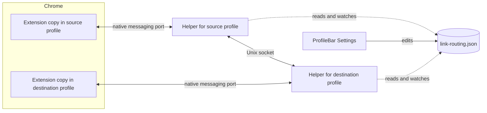
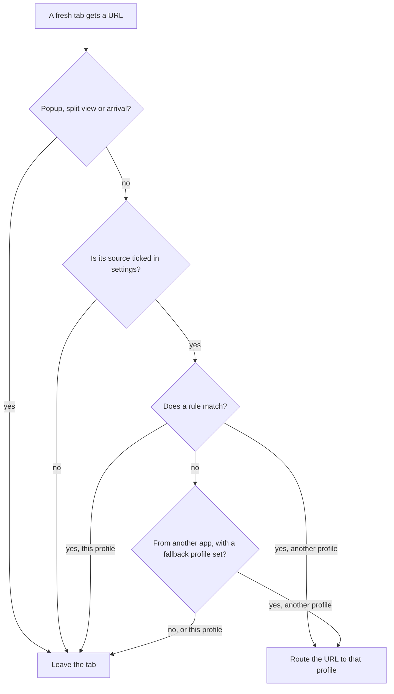
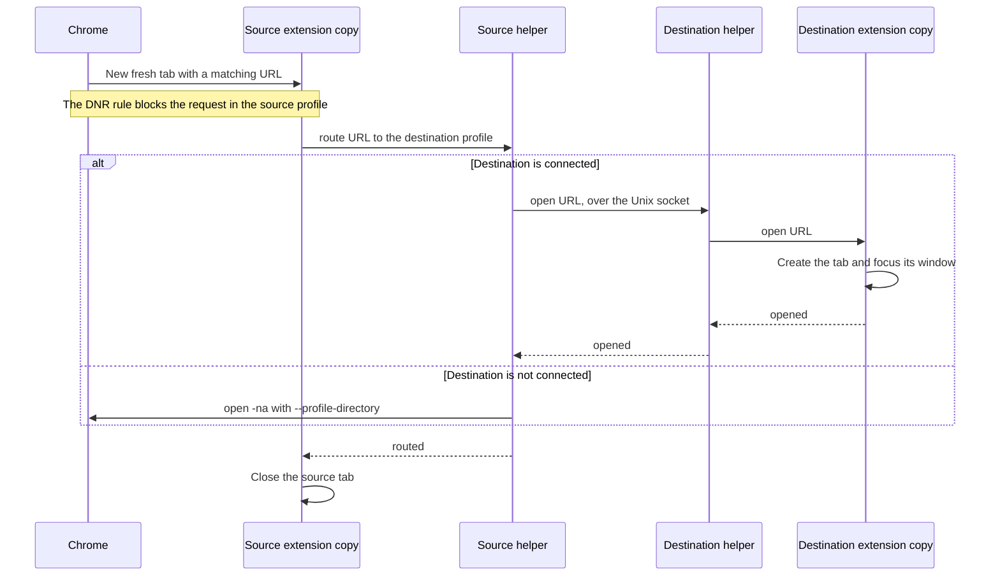
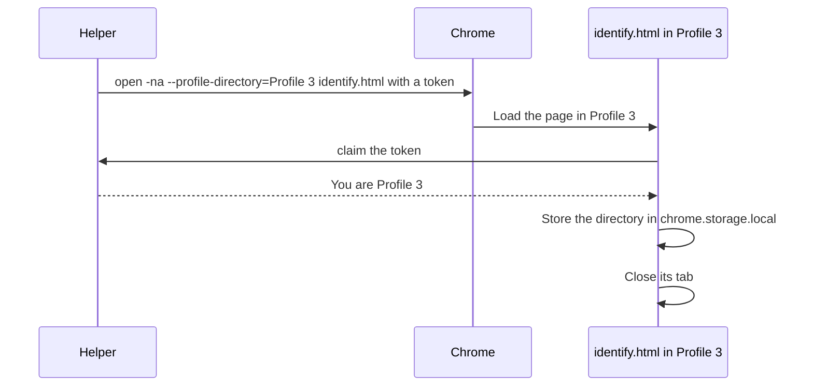

# Link routing design

- **Status:** Accepted
- **Date:** 2 November 2026

ProfileBar for Chrome opens each link in the Chrome profile that a user rule names. It works like Arc's Air Traffic Control. ProfileBar does not become the default browser.

## Goals

- Open links in the correct profile without changing the default browser.
- Keep routing fast. A routed link must appear in its profile almost as fast as a link that Chrome opens there directly.
- Never load a routed page in the wrong profile.

## Terms

- **Source profile:** the profile where Chrome first opens a link. For a link from another app, this is the last profile the user used.
- **Destination profile:** the profile that the matching rule names.
- **Extension copy:** Chrome installs extensions per profile. Each profile runs its own copy of ProfileBar for Chrome.
- **Helper:** the native messaging helper in ProfileBar's app bundle (`Sources/NativeHost`).
- **Fresh tab:** a tab that is less than 5 seconds old, has changed URL at most 3 times, and has shown its first page for less than 1 second. Only fresh tabs are routed.
- **Arrival:** a tab that ProfileBar opened in a profile. Arrivals are never routed.

## Components



- Each extension copy keeps a native messaging port open with `chrome.runtime.connectNative`.
  - Chrome starts one helper process for each open port.
  - An open port keeps the extension's service worker running, so no event waits for it to start.
- Each helper listens on a Unix socket for its own profile.
- Helpers pass routed links to each other over these sockets. The ProfileBar app does not need to run.
- `~/Library/Application Support/ProfileBar/link-routing.json` stores the rules and settings for all profiles.

## Which tabs are routed



The extension detects two sources of new tabs:

- **Other apps:** Chrome creates the tab with its URL already set. `tabs.onCreated` reports it.
- **Web pages:** a page opens a new tab or window. `webNavigation.onCreatedNavigationTarget` reports the URL and the opening tab.
  - This event never fires for links from other apps, so it tells the two sources apart.
  - Chrome gives links from other apps an opener tab too, so `openerTabId` cannot tell them apart.

While a tab is fresh, `tabs.onUpdated` also reports redirects, such as Outlook Safe Links or `google.com/url`. The extension routes the first URL that a rule matches. A client redirect follows its page within moments, while a person needs longer to read a page and click a link, so a tab stops being fresh 1 second after `webNavigation.onCommitted` reports its first page. A slower redirect page leaves the tab where it is.

Links from other apps that match no rule go to the fallback profile, if the user chose one. This matches a default browser profile in Finicky. Links that pages open never use it, so browsing in one profile isn't pulled into another. The fallback applies to the first URL, so a redirect that a rule would match goes to the fallback profile instead.

The extension never routes:

- Navigation inside an existing tab.
- Popup windows. Sign-in flows such as "Sign in with Google" use popups.
- Links opened into a split view, which the user placed beside a page on purpose.
- Arrivals, which are tabs that ProfileBar opens in this profile, such as routed links and moved tabs or groups.
  - The extension opens each arrival blank and exempts its tab ID from request blocking.
  - It then loads the URL, so request blocking never stops an arrival and the page loads once.
- Tabs created in the first 3 seconds after the extension starts.
  - Chrome restores tabs while the extension starts, so restored tabs arrive as new tabs.
  - A link that starts Chrome is therefore not routed. It opens in the last profile the user used.
- Reopened and duplicated tabs, such as a tab brought back with Cmd+Shift+T.
  - Chrome creates them with the page they showed already set as `url`. A new tab has only a `pendingUrl`.

## Routing a link



- The destination extension copy creates the tab in that profile's last-focused window. It then calls `windows.update({ focused: true })`.
  - This brings the window forward, including from another desktop Space.
  - ProfileBar's Accessibility raise is not needed.
- If the destination profile has no window or no connected extension copy, the helper runs `open -na "Google Chrome" --args --profile-directory=<directory> <url>`. This is the same path that tab moves use today.
- The source tab closes only after the helper reports success. This matches the rule for manual moves.
  - If request blocking stopped the source tab and it now shows another URL, the user navigated it, so it stays open.
- The destination reports whether it started opening tabs. The helper falls back to `open -na` only when nothing opened, such as when the profile has no window. If the destination might have opened some tabs, including when it does not answer in time, the helper reports failure instead, so the source tab stays open and no tab opens twice.

### No links during Chrome startup

If a profile receives URLs before Chrome restores its session, Chrome opens only those URLs and does not restore that profile's tabs. The spike caused this once (see [Spike results](#spike-results)).

- For 3 seconds after the extension's service worker starts, the extension sends no URLs to the helper.
  - The service worker starts with Chrome, so this covers session restore. It also restarts after an update or reload, which only delays routing briefly.
  - Routing ignores these tabs, as described in [Which tabs are routed](#which-tabs-are-routed).
  - A manual move or group move chosen in this period waits until the period ends.
- At Chrome startup, all profiles that were open start within a few hundred milliseconds. The source profile's start time is therefore close enough to Chrome's start time.

## Blocking the request in the source profile

Without blocking, the source profile sends the request about 30 ms before the extension can close the tab. That request can use up a one-time link, such as a sign-in or password-reset link.

Each extension copy compiles the rules into `declarativeNetRequest` (DNR) session rules:

- A rule that names another profile becomes a `block` rule.
- A site rule with a path uses `requestDomains` with a `regexFilter`, because a URL filter cannot allow a port between the host and the path.
- Every condition sets `isUrlFilterCaseSensitive: false`. Chrome 116 and 117 default to case-sensitive matching.
- Sign-in sites get an `allow` rule above every other rule, so a rule for a parent site, such as `google.com`, never blocks them.
- If Chrome rejects an update, it keeps the previous rules. An arrival then fails rather than load a page that an old rule might block, and the options page reports the problem. Paths are limited to 256 characters so their patterns stay within Chrome's size limit.
- A rule that names this profile becomes an `allow` rule.
- DNR priority follows rule precedence (see [Rule precedence](#rule-precedence)), so DNR and the extension pick the same winning rule.
- Every rule lists all non-fresh tabs in `excludedTabIds`. This limits blocking to fresh tabs.
  - When a tab stops being fresh, the extension adds it to `excludedTabIds`.
  - Navigation inside an older tab is never blocked.

DNR blocks some tabs that the extension then decides not to route:

- DNR cannot tell a link from another app apart from a link opened by a web page before the request starts. If only one source is ticked, DNR can block a tab from the other source.
- Tabs that Chrome restores or reopens look like fresh tabs to DNR.

In both cases, the extension adds the tab to `excludedTabIds` and reloads it. The blocked request never reached the server, so the page loads once. Another extension can also block a page, so the extension reloads each tab at most once.

The fallback profile has no DNR rule. A catch-all block would also stop every tab that a page opens, because DNR cannot tell the sources apart, and each of those tabs would then need a reload. So a link sent to the fallback profile also loads briefly in the source profile.

## Rules

### Rule kinds

| Kind | Matches | Example |
|---|---|---|
| Host | The host and its subdomains, with an optional path prefix | `github.com` with path `/team` |
| URL contains | Any URL that contains the text | `docs.google.com/a/acme.com` |

The right-click item **Always open this site in ▸ Profile** creates a host rule for the page's exact host.

The options page rejects:

- Host rules for shared sign-in hosts, such as `accounts.google.com`, `login.microsoftonline.com`, and `*.okta.com`. Routing these hosts breaks sign-in in other profiles.
- "URL contains" text with the DNR special characters `*`, `|`, or `^`.

### Rule precedence

1. Host rules win over "URL contains" rules.
2. Among host rules, the longest host wins, then the longest path prefix.
3. Among "URL contains" rules, the longest text wins.
4. If rules still tie, the first rule in the list wins.

Every extension copy uses the same rules and the same precedence. Two copies therefore always agree on the destination, so a link cannot bounce between profiles.

### Settings

```text
Route links from:  ☑ Other apps   ☑ Web pages
```

- Both boxes are ticked by default. With no rules, nothing is routed.
- Clearing both boxes turns routing off.

### Storage

```json
{
  "version": 1,
  "routeFrom": { "otherApps": true, "webPages": true },
  "fallbackProfileDirectory": "Default",
  "rules": [
    { "id": "3f0c…", "kind": "host", "host": "acme.atlassian.net", "pathPrefix": "", "profileDirectory": "Profile 2" },
    { "id": "9a41…", "kind": "contains", "text": "docs.google.com/a/acme.com", "profileDirectory": "Profile 2" }
  ]
}
```

- Rules name profiles by directory, because directories stay stable when a profile is renamed.
- `fallbackProfileDirectory` is optional. Without it, links that match no rule stay where Chrome opens them.
- The helper validates every write:
  - Hosts must be valid host names.
  - Profile directories must pass `ChromeProfile`'s directory check.
  - The file can hold at most 500 rules.
- Each helper watches the file and sends every change to its extension copy. An edit in one profile reaches all open profiles.

### Editing

- **Extension options page:** the rule list, the source checkboxes, the fallback profile, this profile's identity, and an **Identify profiles** button. Every profile shows the same list.
- **Right-click menu:** **Always open this site in ▸ Profile** adds a host rule and moves the current tab.
- **ProfileBar Settings:** a rule table that edits the same file.
- **Test a link:** both editors explain where a pasted link would open and which rule sends it there. ProfileBar has its own copy of the rule matching, and both copies are tested against `extension/test/routing-cases.json`.

Both editors replace the whole file with an atomic write. If two editors save at the same time, the last write wins.

## Profile identity

An extension copy cannot ask Chrome which profile it runs in. ProfileBar tells each copy once:



- The helper opens the page only in profiles where the extension is enabled. It checks Chrome's `Secure Preferences`, as group moves already do.
- Identification runs when the user clicks **Identify profiles**, and when an extension copy reports that it has no identity.
- Each profile shows one tab briefly, one time.
- An extension copy without an identity never routes links and never accepts arrivals.

Other ways to identify a profile do not work:

- Window titles are the same for profiles that share a name. The focused window can also change during the check.
- `chrome.identity` needs the "Know your email address" warning. It also returns nothing for profiles that are not signed in.

## Helper changes

- The helper reads messages until the extension disconnects. One-shot requests from `chrome.runtime.sendNativeMessage` still work, because Chrome closes the input after one message.
- After the extension copy sends its identity, the helper listens on a socket for that profile in a directory that only the user can read.
- A helper that exits must not delete a socket that a newer helper created for the same profile.
- Routing reads nothing from Chrome's data folder. It checks only the profile directory's format.

## Permissions and privacy

| Permission | Status | Use | Warning |
|---|---|---|---|
| `tabs` | Existing | Read new tab URLs | Read your browsing history |
| `nativeMessaging` | Existing | Talk to the helper | None |
| `storage` | New | Store this profile's identity | None |
| `webNavigation` | New | Detect tabs opened by web pages | Read your browsing history (the same warning as `tabs`) |
| `declarativeNetRequest` | New | Block requests in the source profile | Block content on any page |

- Chrome cannot make `declarativeNetRequest` optional. The update therefore disables every installed copy until its user accepts the new warning. The release notes and Web Store listing must explain this.
- `PRIVACY.md` must change. The extension reads the URL of each new tab and compares it with the user's rules on the Mac. It sends only matching URLs to ProfileBar. With no rules, it reads nothing.
- The Web Store justifications for `tabs`, `webNavigation`, and `declarativeNetRequest` must match the new policy.
- `extension/AGENTS.md` must change. The extension sends a URL to the helper after an explicit menu choice, or when the URL matches a rule the user created.
- Each open profile runs one idle helper process, and the extension's service worker stays running in each one.

## macOS 27

macOS 27 blocks other apps from reading `~/Library/Application Support/Google/Chrome`, except its `NativeMessagingHosts` folder. When ProfileBar launches, macOS asks the user for access. The approval appears in **System Settings → Privacy & Security → Files & Folders** as **ProfileBar → Google Chrome**. It also covers the helper when Chrome starts it.

- Routing does not read Chrome's data folder.
- The profile list, avatars, and identification still need the approval.
- If the user declines, ProfileBar fails without explanation. A separate change will show what to allow and link to the setting.

## Compatibility and release

- One pull request changes both ends of the native messaging protocol, as `AGENTS.md` requires.
- ProfileBar ships before the extension.
- An extension copy that finds an older helper turns routing off and asks the user to update ProfileBar. An older helper exits after one message, so the extension waits before it reconnects.

## Spike results

A throwaway spike tested this design on macOS 27.2 with Chrome 156 and four profiles. The spike used a Python helper instead of the Swift helper. Each time runs from the moment `open` or a click sent the link to the moment the tab existed in the destination profile.

| Case | Runs | Range | Median |
|---|---|---|---|
| Link from another app, already in the correct profile | 4 | 72–117 ms | about 100 ms |
| Link from another app, routed through the helpers | 9 | 95–154 ms | about 122 ms |
| Same, with DNR blocking the source request | 4 | 104–188 ms | about 137 ms |
| Link from another app, routed with `open -na` | 4 | 241–296 ms | about 290 ms |
| Link opened by a web page, routed through the helpers | 10 | 59–104 ms | about 80 ms |

Other results:

- Message passing between two helpers took about 1 ms. Most routing time goes to creating and focusing the destination tab.
- The destination profile starts its request 10–30 ms after the source profile would have.
- For a tab opened by a web page, `webNavigation.onCreatedNavigationTarget` reported the URL 14–24 ms after the click (median 20 ms). `tabs.onUpdated` reported it after about 420 ms, when the page had already loaded.
- DNR blocked the request in every fresh source tab. It did not block navigation inside an older tab.
- Focusing the destination window switched to it on another desktop Space.
- The user saw a very brief flash in the source window. Chrome adds the tab to the source window before any extension code runs, so no extension can prevent this.
- Session restore: Chrome restored 17 tabs in the source profile within 10 ms of the extension starting. The spike had no startup rule, so it routed the 2 tabs whose URLs named Profile 2. This result is the reason for the 3-second startup rule.
- The helper for Profile 2 from before the restart had left its socket behind. The relay failed at once with "Connection refused", and the `open -na` fallback opened both tabs.
- Profile 2 had not restored yet when those 2 tabs reached it. Chrome opened only those tabs and the launching link in Profile 2, and did not restore its other tabs. **History → Recently Closed** brought them back. This result is the reason for [No links during Chrome startup](#no-links-during-chrome-startup).

## Alternatives considered

| Alternative | Reason rejected |
|---|---|
| Become the default browser, as Finicky does | The user does not want ProfileBar to own the default browser. The source app is also unreliable for links from `open` and Slack helpers. |
| Route only with `open -na` | It takes about 290 ms, which is slower than Finicky, because Chrome must start a second process. |
| DNR redirect to an extension page | Every profile would need host permissions for every routed site. |
| `openerTabId` to detect links from other apps | Chrome sets it for those links too. |
| Accessibility raise of the destination window | `windows.update` already focuses the window across Spaces. |

## References

- [How to route links to Arc Spaces with Air Traffic Control](https://allthings.how/how-to-route-links-to-specific-arc-spaces-using-air-traffic-control-in-the-arc-browser/)
- [declarativeNetRequest API](https://developer.chrome.com/docs/extensions/reference/api/declarativeNetRequest)
- [webNavigation API](https://developer.chrome.com/docs/extensions/reference/api/webNavigation)
- [Extension service worker lifecycle](https://developer.chrome.com/docs/extensions/develop/concepts/service-workers/lifecycle)
- [Permission warnings](https://developer.chrome.com/docs/extensions/develop/concepts/permission-warnings)
- [Permissions list](https://developer.chrome.com/docs/extensions/reference/permissions-list)
- [Finicky issue 556: macOS 27 blocks browser profile data](https://github.com/johnste/finicky/issues/556)
- [Application Support protection in macOS 27](https://wojciechregula.blog/post/golden-gate-appdata-protection/)
